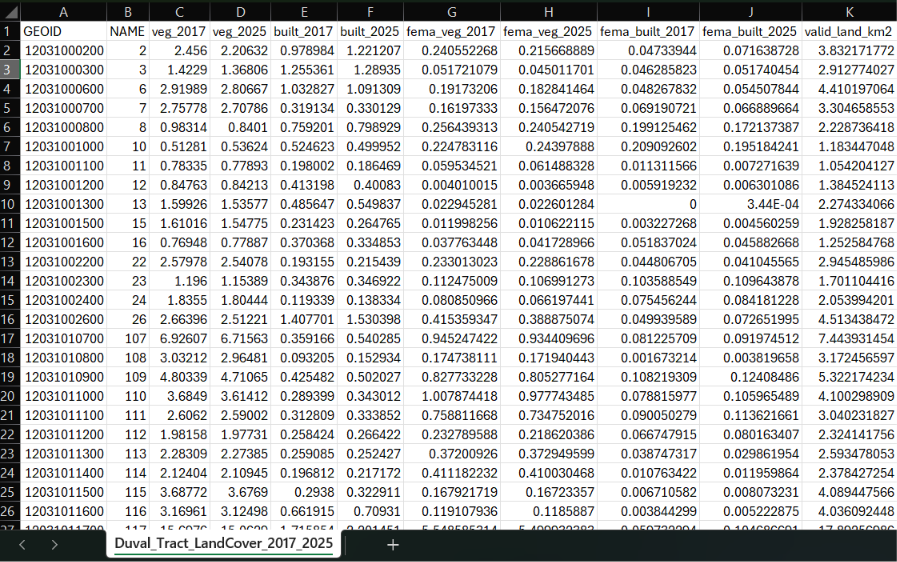
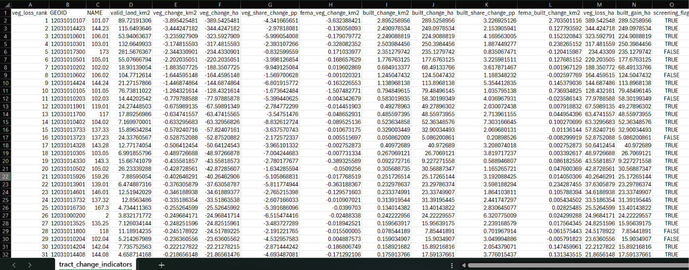

# Duval County Land-Cover Change Analyzer

## 1. Research Question

Which census tracts in Duval County, Florida, experienced the greatest estimated vegetation decline and built-up land-cover increase between 2017 and 2025, particularly within FEMA-designated flood hazard areas?

## 2. Data

The project uses land-cover area measurements derived from Sentinel-2 imagery in Google Earth Engine.

**Data sources:**
- Sentinel-2 Surface Reflectance (2017 and 2025)
- U.S. Census Bureau TIGER/Line census tract boundaries
- FEMA National Flood Hazard Layer
- Reference classification data used for accuracy assessment

**Geographic coverage:** 219 Duval County census tracts.

**Primary input:** Duval_Tract_LandCover_2017_2025.csv

Each record represents one census tract with vegetation, built-up-candidate, and FEMA flood-zone area measurements.

## 3. Input and Output

**Input**
- **Data structure:** tabular CSV
- **Description:** one row per census tract, with 2017 and 2025 measures of vegetation-classified tract area, built-up-candidate tract area, vegetation-classified area in FEMA zones, built-up-candidate area in FEMA zones (219 rows, 11 columns) 
- **File:** `data/Duval_Tract_LandCover_2017_2025.csv`
  


**Output**
- **Data structure:** tabular CSV
- **Description:** one row per census tract, with calculated indicators of land cover change from 2017- 2025 (219 rows, 15 columns) 
- **File:** `data/tract_change_indicators.csv` (to be created)



The Python program creates new data, including vegetation change, built-up-candidate change, percentage-point change in land-cover share, FEMA-zone change, ranking, and screening flags.

## 4. Data Structures

The primary data structure is a **pandas DataFrame**, which organizes census tract measurements into rows and columns.

Additional structures include:
- **Lists:** Specify required fields and support validation.
- **Dictionaries:** Store descriptive labels for land-cover categories.
- **Boolean Series:** Represent the conditions used to identify census tracts for screening.
- **NumPy arrays:** Support numerical operations and validation tests.

These structures make it easier to preserve census tract identifiers, perform calculations consistently, and sort geographic records.

## 5. Data Loading Code

The primary script is Duval_Tract_Analyzer_Whittier.ipynb.

```python
tracts = pd.read_csv(
    DATA_DIR / 'Duval_Tract_LandCover_2017_2025.csv',
    dtype={'GEOID': str, 'NAME': str}
)
```

If running outside of Google CoLab use: 
 
```python
from pathlib import Path

DATA_DIR = Path("data")
OUTPUT_DIR = Path("outputs")
OUTPUT_DIR.mkdir(exist_ok=True)

USE_DEMO = False
INPUT_FILE = "Duval_Tract_LandCover_2017_2025.csv"
```

## 6. Processing Workflow

1. Load census tract-level land-cover measurements.
2. Validate required fields, duplicate GEOIDs, missing values, and geographic area constraints.
3. Calculate changes between 2017 and 2025.
4. Convert square kilometers to hectares and calculate changes in land-cover share.
5. Calculate changes within FEMA flood hazard areas.
6. Apply transparent screening criteria.
7. Rank census tracts by estimated vegetation-class decline.
8. Export new CSV datasets and supporting figures.

## 7. Outputs

The program generates:

- outputs/tract_change_indicators.csv — All calculated indicators, screening flags, and rankings.
- outputs/top10_vegetation_loss.csv — The ten census tracts with the largest absolute vegetation-class declines.
- outputs/tract_vegetation_loss.png — A chart displaying the top ten tracts.

These results are intended for screening and further investigation, not for predicting flooding.

## 8. Validation

The program includes checks for:

- Missing or duplicate records.
- Invalid area measurements.
- FEMA-area measurements exceeding total classified areas.
- Correct area-change and unit-conversion calculations.
- Correct ordering of ranked census tracts.
- Reconciliation with countywide Google Earth Engine area statistics.

A negative-area test demonstrates that invalid data is rejected.

## 9. Limitations

Land-cover classifications have uncertainty, particularly when distinguishing built-up surfaces from bare soil or other land types. Census tracts vary in size, which can influence absolute area rankings. FEMA flood-zone intersections indicate mapped exposure, not observed flood events or changes in flood risk.

Future work could improve classification accuracy, use additional observation years, and incorporate other socioeconomic or environmental indicators.

## 10. References


